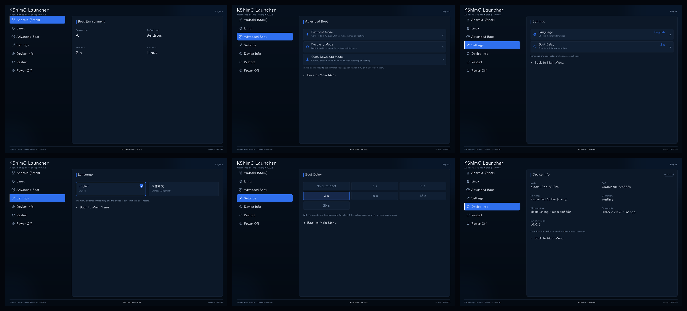

# kShimC4sheng

A boot menu for the Xiaomi Pad 6S Pro (sheng / SM8550), replacing
`fastboot set_active a|b` and WoaManager's flash-based dual-boot switching.

**English** | [简体中文](README.zh-CN.md)

After flashing to `boot_a`, every boot starts with the menu:

- **Android** — jumps to the stock kernel; ABL continues with
  `init_boot_a` / `vendor_boot_a` / `dtbo_a`. No slot switch, no reboot.
- **Linux** — boots the `linux` partition with an embedded Image + DTB
  (and optional initrd), using `root=PARTLABEL=linux`.

Touch is not supported; use the volume keys to move and the power key to confirm.



## Status

Verified on hardware: the stock Android system and Debian forky/KDE both boot
from the menu. Language, boot delay, last-boot record, Recovery/Fastboot and
the charger screen work.

- UI: Atlas, six pages (Boot environment / Advanced boot / Settings /
  Language / Boot delay / Device info).
- Menu-to-OS handoff: about 13 s (Android) / 11 s (Linux); the first switch to
  a different entry adds about 6 s for the SDAM write.
- Lives in `boot_a`, slot A; no `misc`, no `slot_suffix` changes.
- Keep your own stock `boot_a` and GPT backup locally; do not commit them.
- Rollback: `fastboot flash boot_a /path/to/stock-boot.img`.

## Quick start

Requirements: unlocked bootloader, a stock `boot_a` image, and a distro
`boot.img` (or a kernel `Image` + DTB).

```sh
# From a distro boot.img
scripts/make-boot.sh \
  --stock-boot stock_boot_a.img \
  --distro-boot debian-boot.img \
  --out out/boot_a.img

# Or from kernel build outputs
scripts/make-boot.sh \
  --stock-boot stock_boot_a.img \
  --linux-image Image \
  --dtb sm8550-xiaomi-sheng.dtb \
  --initrd initramfs.img \
  --out out/boot_a.img
```

Only `python3` + `bash` are required. The packer is built automatically on
first use. If you do not change the runtime, no cross compiler is needed:
`prebuilt/sheng-runtime.bin` is used as-is.

Test with a one-shot boot first; nothing is written to the partition:

```sh
scripts/test_boot.sh --image out/boot_a.img
```

Once the menu, Android and Linux all work, flash it:

```sh
scripts/flash.sh --image out/boot_a.img
```

`make-boot.sh` preserves the stock boot header version and rejects images
larger than 192 MiB. For Windows, see [`windows/README.md`](windows/README.md).

## Menu

| Page | Contents |
| --- | --- |
| Boot environment | Current slot, default boot, auto-boot delay, last boot |
| Advanced boot | Fastboot, Recovery, 9008; current boot only |
| Settings | Language and boot delay, persisted in NVM |
| Language | English (default) / Simplified Chinese, applied immediately |
| Boot delay | No auto-boot, 3/5/8/10/15/30 seconds |
| Device info | Model, SoC, DT model/memory/compatible list, framebuffer, version |

Volume `+/-` moves, power confirms. An Android OTA overwrites `boot_a` and
removes the menu; flash the image again afterwards.

## Building the runtime (optional)

Only needed when changing the menu or its configuration:

```sh
scripts/fetch_toolchain.sh   # Arch/CachyOS: unpacks a cross compiler automatically
scripts/fetch_deps.sh        # CrDK / picolibc / LVGL / libfdt
scripts/build_runtime.sh config/sheng_defconfig out/runtime
```

The result must be exactly 4 MiB and is copied to `out/runtime.bin`;
`make-boot.sh` picks it up automatically.

## Layout

```text
packer/     boot image parsing, payload extraction, manifest packing/verification
config/     sheng partition/default configuration and defconfig
scripts/    build, backup, test boot, flash
vendor/     kShimC runtime and MultiBootKernelPatcher
prebuilt/   sheng runtime (no cross compiler required)
docs/       architecture, device data, dual-boot install, troubleshooting, provenance
tests/      pure-Python synthetic image regression tests
```

## Known limitations

- Display uses the `cont_splash_region` forced framebuffer; SDE routing is still
  undecoded, so a changed splash reservation may produce a black screen.
- Touch is unavailable; EDL recovery depends on a Xiaomi service account.
- `fastboot boot` is not fully equivalent to a normal boot regarding
  bootconfig/vendor_boot; trust the flashed behavior for the Android entry.
- The last-boot record is best-effort: if the PMIC clears SDAM, Android is the
  fallback default.
- Only `boot_a` is written; `super`, `userdata` and `linux` are untouched.

## Documentation

- [Architecture and boot chain](docs/architecture.md)
- [Device profile](docs/device-profile.md)
- [Android + Debian dual boot](docs/sheng-debian-dual-boot.md)
- [Troubleshooting](docs/troubleshooting.md)
- [Provenance and licenses](docs/provenance.md)
- [Changelog](CHANGELOG.md)

## License

GPL-3.0 (inherited from kShimC). See [`LICENSES.md`](LICENSES.md) for
third-party components and image redistribution notes.
