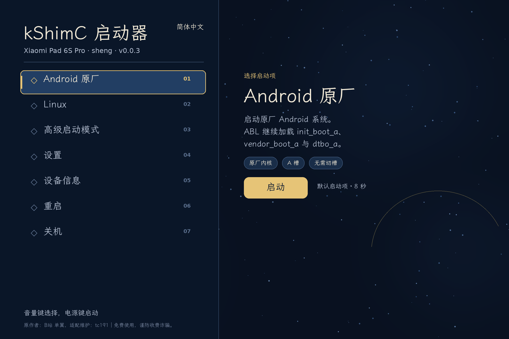
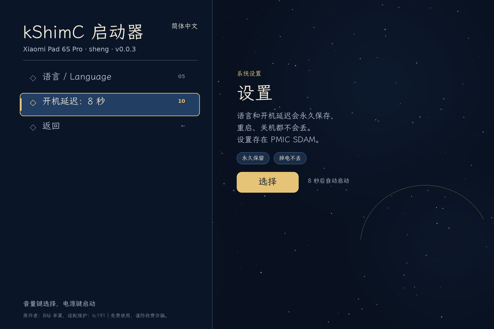
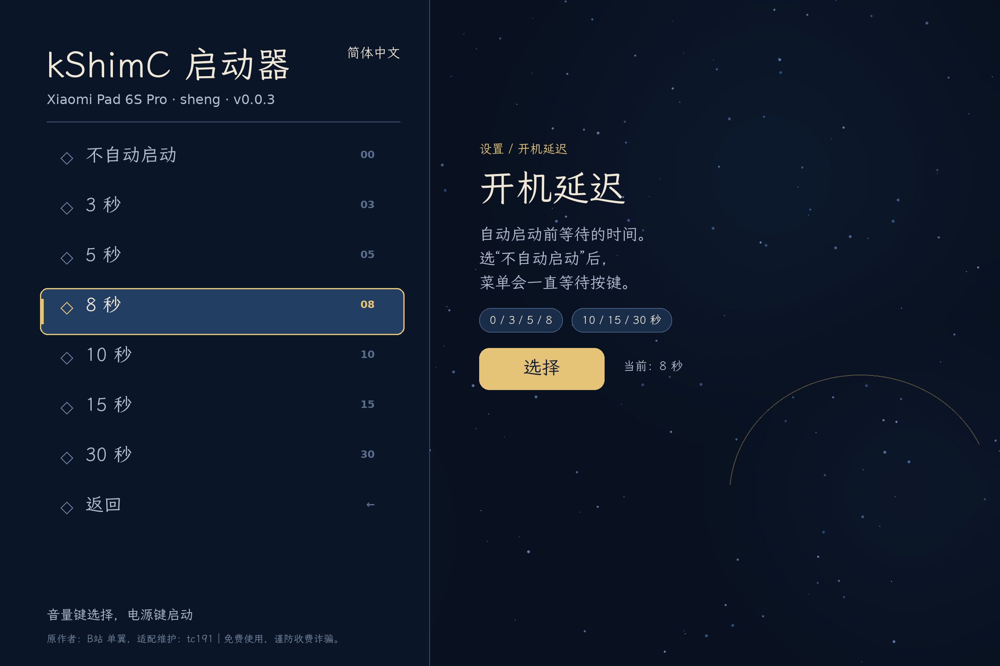
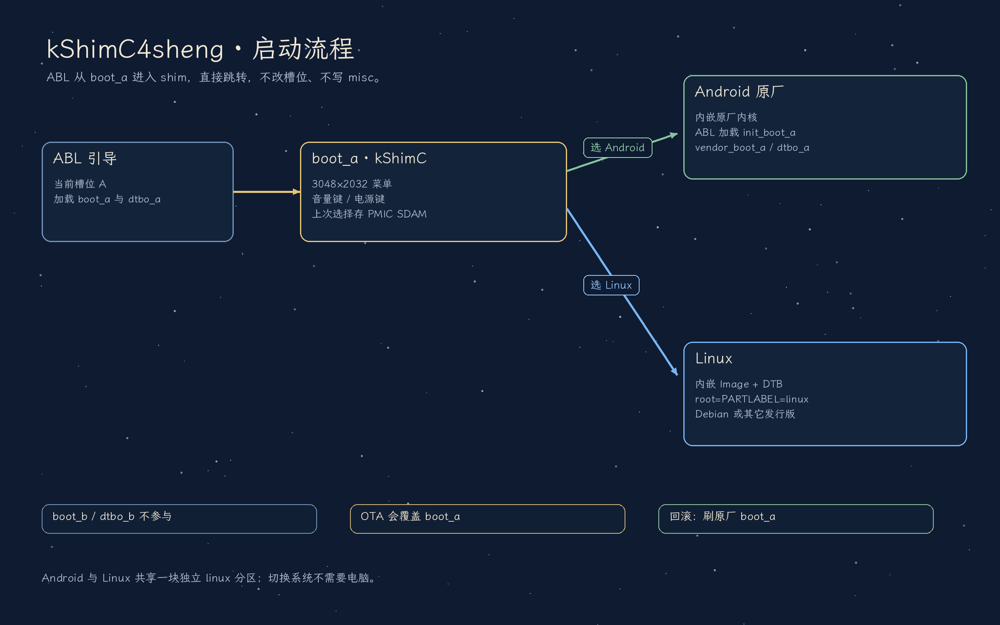

# kShimC4sheng

为 **小米平板 6S Pro（sheng / SM8550）** 做一个开机菜单，替代现在
`fastboot set_active a|b` / WoaManager 刷 boot 分区的双系统切换方式。

刷入后每次开机先进入 kShimC 菜单：

- **Android**：直接跳转原厂内核，ABL 仍会加载 `init_boot_a` / `vendor_boot_a` /
  `dtbo_a`，不重启、不切槽。
- **Linux**：用内嵌的 Linux Image + DTB + 可选 initrd 启动 `linux` 分区上的
  rootfs（`root=PARTLABEL=linux`）。

首次启动默认 8 秒后进 Android，之后会记住上次启动的系统；音量键选择、
电源键确认（sheng 的触屏驱动未适配，与两代 Y700 一样只用按键）。

> 状态：**真机双系统已跑通（2026-10-27，sheng / A 槽，kShimC 0.0.4）**。
> Android 原厂与 Debian forky/KDE 都能从菜单正常引导。
> 当前 `boot_a` = `out/boot_a_v003.img`，90,005,504 B，sha256
> `e18dd5621c24a9dd3bef8eeb1e39c203c0913d29dcd11a004e39a010964e704d`。
> `linux` 分区 128 GiB（`PARTLABEL=linux`），`userdata` 104.4 GiB。
> 菜单 7 项、音量键/电源键，会记住上次启动的系统（PMIC SDAM）；
> 选中后底部显示“正在启动，请稍候”。设置页支持语言和开机延迟，
> 两项都会永久保留；高级启动顺序为 Fastboot → Recovery → EDL。
> 关机插电会进入内置充电界面，长按电源键回菜单。
> 备份（原厂 boot/GPT/全部分区）在 `/home/tc191/6spBackup/rom/`；
> 原厂 `boot_a` 回滚：`fastboot flash boot_a stock/boot_a-stock.img`。
> 详细步骤见 `docs/sheng-debian-dual-boot.md`。

变更记录见 [CHANGELOG.md](CHANGELOG.md)。

## 界面

| 主菜单 | 设置 | 开机延迟 |
| --- | --- | --- |
|  |  |  |

| 充电模式 | 启动流程 |
| --- | --- |
|  |  |

## 已验证 / sheng 适配要点

- 菜单：3048×2032 横屏、STAR_CHART 双栏；只列 Android / Linux / 高级启动 /
  设置 / 设备信息 / 重启 / 关机（`CONFIG_KSHIM_MENU_SINGLE_LINUX`，无 TF 行）。
- 显示：SM8550 的 SDE 10 SSPP legacy 解码仍失败，改用
  `CONFIG_KSHIM_SPLASH_FALLBACK`：直接复用 ABL 的 `cont_splash_region`
  （0xB8000000，stride 12192，XRGB8888）作为扫描缓冲。SDE 路由解码本身尚未修。
- 按键：`qcom,sm8550-tlmm` + `pmk8550-pwrkey` 直接可用；触屏未适配。
- 高级启动：SM8550 的 PMIC 仲裁器是 **v7**，原代码只接受 v8/8.5；已放宽到
  CrDK 支持的 5/7/8/8.5。Recovery/Fastboot 已验证，EDL 未试。
- 设备信息：ABL DT 根是 `qcom,kalama*` 而非 `qcom,sm8550`，已兼容；
  内存 7888 MiB（`/memory` 里有一个 size=0 的占位 bank，已跳过）。
- 设备信息识别为 `Xiaomi Pad 6S Pro (sheng / SM8550)`；0.0.2 起设备固定为
  sheng，设置页不再显示设备选择。
- 上次启动/设置：`CONFIG_KSHIM_BOOT_LAST` 把选中条目、语言和开机延迟写进
  PMIC SDAM `0x8400/0x8500` 的 `0x50/0x80`（`KSET` v2 记录 + CRC32，双份回退）。
  没有记录或记录失效时回退 manifest 默认（Android），不会阻止手动选择。
- 充电模式：识别 `androidboot.mode=charger` 后跳过菜单，显示内置
  `CHARGER CONNECTED` 界面，长按电源键 2 秒回菜单；不依赖发行版服务。
- 启动提示：确认条目后先渲染“正在启动，请稍候”再交接内核，避免停在菜单
  画面让人误以为卡死。

## 为什么放在 boot_a

sheng 是 A/B 设备，ABL 按当前槽位加载 `boot_x`、`init_boot_x`、
`vendor_boot_x`、`dtbo_x`。把 shim 放在 **boot_a** 并让设备停在 A 槽：

- Android 的 ramdisk/DTBO 与 `system_a` 天然对齐，不需要伪造 `slot_suffix`；
- 选 Android 时 shim 恢复原厂内核头并直接跳转，不经过 secondary bootloader；
- 选 Linux 时不碰 `misc`/BCB，不需要 root、WoaManager 或电脑。

代价：Android OTA 会覆盖 `boot_a`，菜单随之消失，需要重新刷一次。

## 目录

```
packer/            boot 镜像解析、载荷提取、打包、manifest 校验
  bootimg.py       Android boot v0-v4 读写
  extract.py       从 stock / 社区 boot.img 提取 kernel、DTB、initrd
  make_boot.py     调 MultiBootKernelPatcher，产出 boot_a.img
  fdt.py           纯 Python FDT 读写（替代 dtc/fdtput，Windows 可用）
  manifest.py      kShimC manifest 解析（校验用）
config/
  sheng.env        分区大小、默认项、cmdline
  sheng_defconfig  kShimC runtime 配置（3048 宽、按键、无触屏）
scripts/
  prepare.sh       提取 stock 内核 + Linux 载荷
  build.sh         生成 out/boot_a.img
  build_runtime.sh 构建 4 MiB kShimC runtime
  fetch_deps.sh    拉取 CrDK/picolibc/LVGL/libfdt（GitHub 镜像，需网络）
  fetch_toolchain.sh 在本机解包 aarch64 交叉工具链（Arch，无需 root）
  backup.sh        通过 adb 备份 boot/dtbo/init_boot/vendor_boot
  backup-partitions.sh  备份除 super/userdata 外的全部分区 + 主/备 GPT
  flash.sh         刷 boot_a
vendor/
  kshim/           五代 kShimC 快照（GPL-3.0）
  packer/          MultiBootKernelPatcher（GPL-3.0-or-later）
windows/           Windows 一键构建（.bat + build.py）
prebuilt/          sheng runtime 与 Windows 可执行文件
tests/             纯 Python 回归（合成镜像，不需要设备）
docs/              架构、设备资料、上机计划、排障、来源
```

## 最简构建（推荐）

只要 **原厂 boot 镜像** 和 **Linux 的编译产物**，一条命令出可刷的 `boot_a.img`：

```sh
# Linux 产物是发行版的 boot.img（Image.gz + DTB [+ initrd]）
scripts/make-boot.sh \
  --stock-boot stock_boot_a.img \
  --distro-boot debian-sheng-boot.img \
  --out out/boot_a.img

# 或者直接给 Linux 内核构建输出
scripts/make-boot.sh \
  --stock-boot stock_boot_a.img \
  --linux-image arch/arm64/boot/Image \
  --dtb arch/arm64/boot/dts/qcom/sm8550-xiaomi-sheng.dtb \
  --initrd initramfs.img \
  --out out/boot_a.img
```

- Linux：只需要 `python3` + `bash`（DTB 编辑已改为纯 Python，不再需要 `dtc`/`fdtput`）；第一次会自动用 `cmake` 编译打包器。
- Windows：见下面的“Windows 一键构建”。
- **不需要交叉编译器**：默认复用仓库里的 `prebuilt/sheng-runtime.bin`
  （4 MiB，sha256 `d8e1becb…`）。只有改菜单/配置时才需要重建 runtime。
- `--stock-boot` 可以是整块 `boot_a` 分区 dump，也可以是裁剪过的 boot 镜像。
- `--linux-image` 支持未压缩的 ARM64 `Image`，也支持内核构建直接产出的
  `Image.gz`（会自动解压）。
- 输出会保留原厂 boot 头版本与分区大小，并检查不超 192 MiB。

### Windows 一键构建

把 **原厂 `boot_a.img`** 和 **发行版 `boot.img`** 一起拖到
`windows\一键构建.bat` 上（第一个是原厂，第二个是发行版），或：

```bat
windows\一键构建.bat stock_boot.img debian-boot.img out\boot_a_win.img
```

- 只需要 Python 3.9+；不需要 bash、MSYS2、dtc 或交叉编译器。
- 打包器使用 `prebuilt/windows/MultiBootKernelPatcher.exe`（x86-64，已随仓库提供）。
- 默认输出 `out\boot_a_win.img`；更多参数见 `windows/README.md`。

## 快速开始（完整流程）

```sh
make packer                       # 编译 MultiBootKernelPatcher

# 1. 准备 payload
scripts/prepare.sh \
  --stock-boot  stock_boot_a.img \
  --distro-boot debian-sheng-boot.img \
  --out out/payload

# 2. 构建 runtime（Arch/CachyOS 可自动装工具链，其他发行版装 aarch64-linux-gnu-gcc）
scripts/fetch_toolchain.sh
scripts/fetch_deps.sh
scripts/build_runtime.sh

# 3. 打包
scripts/build.sh --payload out/payload --runtime out/runtime.bin --out out/boot_a.img

# 4. 先一次性启动测试（不写 flash，失败自动回到原启动）
scripts/test_boot.sh

# 当前在 B 槽 / dtbo_b 已擦除时，先做一个 Linux 默认项的镜像再测菜单：
scripts/build.sh --payload out/payload --runtime out/runtime.bin \
                 --default linux --out out/boot_test.img
scripts/test_boot.sh --image out/boot_test.img

# 5. 备份 + 刷入
scripts/backup.sh
scripts/flash.sh -y
```

`fastboot boot` 是 ABL 的一次性加载：不写 `boot_a`，崩溃/重启就回到原来的
启动链。注意它和正常启动的 `init_boot`/`vendor_boot`/bootconfig 加载路径
可能不同，**Android 条目最终要以刷入后的行为为准**；Linux 条目用的是内嵌
DTB + initrd，更适合用这种方式先验证菜单和 Linux 启动。

没有 `aarch64-linux-gnu-gcc` 时，runtime 也可以在任意装了该交叉编译器的
容器/发行版里构建，只要把产物放到 `out/runtime.bin`。打包阶段只需要
`out/runtime.bin`，不需要重新编译 runtime。本次构建产物：
4,194,304 B，sha256 `a24ac1ef81c11abbaa2e640b3dc0b1f8928f508fe1dfa035d9761773ceaacbb4`。

## 迁移步骤（从现有双系统）

1. 备份 `boot_a`、`boot_b`、`dtbo_a`、`dtbo_b`、`init_boot_a`、`vendor_boot_a`。
2. 确认 Android 在 A 槽并能正常启动：`fastboot set_active a && fastboot reboot`。
3. 保留 `linux` 分区上的 rootfs（重刷官方包会重建 `userdata`，需要重新分区、
   重新写 rootfs）。
4. 刷 `boot_a`，重启，菜单出现。默认 Android 与刷入前行为一致。
5. 需要回滚：`fastboot flash boot_a out/backup/boot_a.img`。

## 已知风险

- 显示走 forced-framebuffer 回退：直接写 `cont_splash_region`，没有走 SDE
  路由解码；如果以后 Android 改了 splash 保留区或 ABL 不再保留它，菜单会黑屏。
- `fastboot boot` 与正常开机在 `init_boot`/`vendor_boot`/bootconfig 的加载路径
  上可能不同，Android 条目最终以刷入后的行为为准。
- 触屏不可用（与两代 Y700 一致），只能音量/电源键。
- Android OTA 覆盖 `boot_a` 后菜单消失。
- “上次启动”记录是 best-effort：PMIC/固件可能在断电、深放电或某些复位路径
  清掉 SDAM 的 `0x8400/0x8500`。记录失效只会回到 Android 默认，不会影响
  手动选择；不依赖 RTC，也不会改动系统时钟。
- 解锁 bootloader 是前提；sheng 的 EDL 恢复需要小米 service account。
- 本项目不修改 `super`、`userdata`、`linux` 分区，只写 `boot_a`。

## 来源与上游

本项目不是从零实现，主要继承关系：

- **kShimC runtime**：上游 [sunflower2333/kShimC](https://github.com/sunflower2333/kShimC)；
  本仓库的 `vendor/kshim/` 是 [mydanyi/armadaos-freedom](https://github.com/mydanyi/armadaos-freedom)
  提交 `244b74516d99d06cb0518609ce4b842ab278be8a` 中 `kshim-success-source` 的快照。
- **MultiBootKernelPatcher**：`vendor/packer/`，来自
  [Project-Aloha/DualBootKernelPatcher](https://github.com/Project-Aloha/DualBootKernelPatcher)
  （v2.0.0.0，DuoWoA/AlohaWoA）。
- **双系统布局 / 安装文档**：[code002-2/Xiaomi-pad-6s-pro-Linux](https://github.com/code002-2/Xiaomi-pad-6s-pro-Linux)。
- **Debian rootfs**：[ianchb/debian-sheng](https://github.com/ianchb/debian-sheng)；
  内核/boot：[ianchb/sm8550-mainline](https://github.com/ianchb/sm8550-mainline)
  release `7.2.6-mac`；固件：[ianchb/sheng-firmware](https://github.com/ianchb/sheng-firmware)。
- **TWRP**：[NoobMaster233/twrp-sheng-build](https://github.com/NoobMaster233/twrp-sheng-build)
  v1.0.1；分区/头版本参考：[map220v/android_device_xiaomi_sheng](https://github.com/map220v/android_device_xiaomi_sheng)。

`sheng` 设备适配、纯 Python FDT 编辑器、Windows 一键构建和本项目脚本是
本仓库新增/修改的部分，逐项记录见 [`docs/provenance.md`](docs/provenance.md)。

## 许可证

本项目按 **GPL-3.0** 发布（继承自 kShimC）。第三方组件、revision 和生成的
boot 镜像注意事项见 [`LICENSES.md`](LICENSES.md) 与
[`docs/provenance.md`](docs/provenance.md)。

## 测试

```sh
make test
```

测试用合成 boot 镜像覆盖：v4 stock 解析、v0 `Image.gz`+DTB 提取、manifest
布局、DTB `bootargs`、initrd 条目、超限拒绝、gzip 内核拒绝。

`vendor/` 下为上游副本或按上游 revision 拉取的依赖，见各自 LICENSE。
