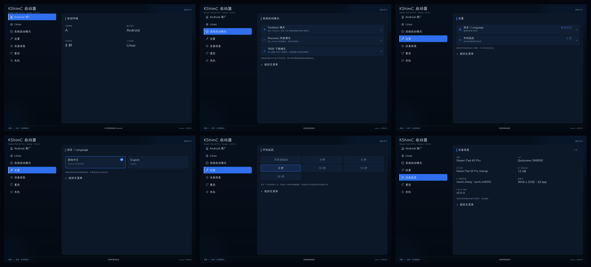

# kShimC4sheng

[English](README.md) | **简体中文**

小米平板 6S Pro（sheng / SM8550）的开机菜单，替代 `fastboot set_active a|b`
和 WoaManager 的刷写式双系统切换。

刷入 `boot_a` 后，每次开机先进入菜单：

- **Android**：跳转原厂内核，ABL 继续加载 `init_boot_a` / `vendor_boot_a` /
  `dtbo_a`，不切槽、不重启。
- **Linux**：用内嵌的 Image + DTB（+ 可选 initrd）启动 `linux` 分区，
  根文件系统为 `root=PARTLABEL=linux`。

触屏未适配，使用音量键选择、电源键确认。



## 状态

真机已验证：Android 原厂与 Debian forky/KDE 均可从菜单启动；语言、开机延迟、
上次启动记录、Recovery/Fastboot 和关机充电界面可用。

- 当前 UI：Atlas 六页（启动环境 / 高级启动 / 设置 / 语言 / 开机延迟 / 设备信息）。
- 常驻 `boot_a`，A 槽；不使用 `misc`、不切换 `slot_suffix`。
- 分区：`linux` 128 GiB，`userdata` 104.4 GiB。
- 原厂完整备份：`/home/tc191/6spBackup/rom/`。
- 回滚：`fastboot flash boot_a /home/tc191/6spBackup/rom/stock/boot_a-stock.img`。

## 快速开始

需要：解锁 bootloader、原厂 `boot_a` 镜像、发行版的 `boot.img`（或内核
`Image` + DTB）。

```sh
# 发行版 boot.img
scripts/make-boot.sh \
  --stock-boot stock_boot_a.img \
  --distro-boot debian-boot.img \
  --out out/boot_a.img

# 或内核构建产物
scripts/make-boot.sh \
  --stock-boot stock_boot_a.img \
  --linux-image Image \
  --dtb sm8550-xiaomi-sheng.dtb \
  --initrd initramfs.img \
  --out out/boot_a.img
```

只依赖 `python3` + `bash`，首次会自动编译打包器；不改 runtime 时不需要交叉
编译器，直接使用 `prebuilt/sheng-runtime.bin`。

先一次性启动验证，不写分区：

```sh
scripts/test_boot.sh --image out/boot_a.img
```

确认菜单、Android、Linux 都正常后再刷入：

```sh
scripts/flash.sh --image out/boot_a.img
```

`make-boot.sh` 会保留原厂 boot 头版本，并检查镜像不超过 192 MiB。
Windows 构建见 [`windows/README.zh-CN.md`](windows/README.zh-CN.md)。

## 菜单

| 页面 | 内容 |
| --- | --- |
| 启动环境 | 当前槽位、默认启动、自动启动秒数、上次启动 |
| 高级启动 | Fastboot、Recovery、9008；仅本次开机有效 |
| 设置 | 语言、开机延迟，写入 NVM 持久保存 |
| 语言 | English（无保存时默认）/ 简体中文，切换后立即生效 |
| 开机延迟 | 不自动启动、3/5/8/10/15/30 秒 |
| 设备信息 | 机型、SoC、DT 型号/内存/兼容列表、帧缓冲、版本 |

音量 `+/-` 移动，电源键确认。Android OTA 会覆盖 `boot_a`，菜单随之消失，
重新刷一次即可。

## 构建 runtime（可选）

仅在修改菜单/配置时需要：

```sh
scripts/fetch_toolchain.sh   # Arch/CachyOS 可自动解包交叉编译器
scripts/fetch_deps.sh        # CrDK / picolibc / LVGL / libfdt
scripts/build_runtime.sh config/sheng_defconfig out/runtime
```

产物必须是 4 MiB，输出到 `out/runtime.bin`；`make-boot.sh` 会自动使用它。

## 目录

```text
packer/     boot 镜像解析、载荷提取、manifest 打包与校验
config/     sheng 的分区/默认项配置与 defconfig
scripts/    构建、备份、测试启动、刷机
vendor/     kShimC runtime 与 MultiBootKernelPatcher
prebuilt/   sheng runtime（免交叉编译）
docs/       架构、设备资料、双系统安装、排障、来源
tests/      纯 Python 合成镜像回归
```

## 已知限制

- 显示使用 `cont_splash_region` 强制 framebuffer；SDE 路由解码仍未修，splash
  保留区变化时可能黑屏。
- 触屏不可用；EDL 恢复依赖小米 service account。
- `fastboot boot` 与正常启动的 bootconfig/vendor_boot 路径不完全等价，
  Android 条目以刷入后的行为为准。
- 上次启动记录是 best-effort：PMIC 清 SDAM 时回退 Android 默认。
- 只写 `boot_a`，不改 `super`、`userdata`、`linux`。

## 文档

- [架构与启动链](docs/architecture.zh-CN.md)
- [设备资料](docs/device-profile.zh-CN.md)
- [Android + Debian 双系统](docs/sheng-debian-dual-boot.zh-CN.md)
- [排障](docs/troubleshooting.zh-CN.md)
- [来源与许可证](docs/provenance.zh-CN.md)
- [变更记录](CHANGELOG.zh-CN.md)

## 许可证

GPL-3.0（继承自 kShimC）。第三方组件与镜像分发注意事项见
[`LICENSES.zh-CN.md`](LICENSES.zh-CN.md)。
